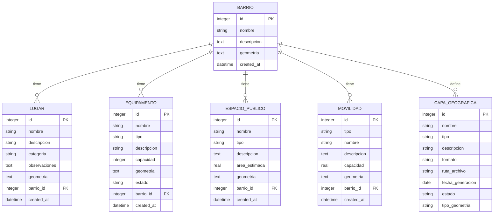

# Modelo de datos (lisboa360-backend)

## 1. Entidades y tablas (SQLite)

| Tabla | Entidad | Responsabilidad |
|---|---|---|
| `barrio` | Barrio | Información general del barrio Lisboa (nombre, descripción, geometría del perímetro). |
| `lugar` | Lugar | Lugares de interés geográfico con geometría puntual y referencia al barrio. |
| `equipamiento` | Equipamiento | Equipamientos del barrio (saneamiento, salud, seguridad, alumbrado, etc.). |
| `espacio_publico` | Espacio público | Espacios públicos del barrio (parques, plazas, playas, zonas verdes, etc.). |
| `movilidad` | Movilidad | Elementos de movilidad del barrio (paradas de transporte público, ciclovías, accesos, zonas de tránsito, etc.). |
| `capa_geografica` | Capa geográfica | Registro de capas geográficas disponibles (nombre, tipo, formato, ruta, estado). |

## 2. MER — Diagrama de entidad-relación

## 3. Decisión: SQLite es suficiente

SQLite es la base de datos propuesta para la versión inicial del proyecto por las siguientes razones:

1. **Volumen de datos bajo:** El modelo inicial almacena información de un solo barrio en un entorno universitario; los registros esperados son suficientemente pequeños para los estándares de SQLite.
2. **Escritura mínima y transacciones:** El modelo de uso inicial es ligeramente orientado a lectura (consultas de capas, equipamientos, espacios públicos y movilidad). SQLite gestiona transacciones atómicas con garantías suficientes sin necesidad de configuraciones de servidor.
3. **Despliegue simple:** SQLite requiere un solo archivo (`app/data/lisboa360.db`), sin procesos dedicados, puertos ni dependencias de red.
4. **Sin dependencia de servidores externos:** Reduce la infraestructura requerida para el desarrollo y pruebas universitarias.
5. **Curva de adopción acorde al alcance:** No existen requerimientos funcionales actuales que justifiquen escalar a PostgreSQL + PostGIS ni consultas espaciales masivas; se evalúa escalar antes de la Fase 2.

## 4. Alternativas descartadas

- **PostgreSQL con PostGIS:** Descartada para la v1 por su complejidad de despliegue, requiere de un servidor dedicado y curva de aprendizaje más pronunciada; no hay requerimientos funcionales que lo requieran en la fase actual.
- **MongoDB:** Descartada por la falta de esquema relacional (los datos siguen un modelo tabular), por ser una tecnología desactualizada respecto al modelo inicial, y por la sobrecarga tecnológica.
- **Archivos CSV/GeoJSON puros:** Descartados por la falta de consultas relacionales, validación de parámetros y paginación eficiente; se prefiere una capa DAO sobre SQLite para separar responsabilidades.

## 5. Restricciones y decisiones asumidas

- La base de datos no se expone a la red; el acceso ocurre exclusivamente desde el backend (Backend ↔ SQLite).
- No se realizan cargas masivas de datos en la Fase 1; el acceso a datos por parte del backend permite ingresar información real posteriormente.
- Las geometrías de equipamientos, lugares y movilidad se almacenan como texto GeoJSON en columnas (`geometria`); las capas geográficas (archivos grandes) se referencian mediante `ruta_archivo` y se servirán por `GET /api/v1/capas/{capaId}/geojson`.
- Los campos nulables (`descripcion`, `capacidad`, `area_estimada`, `observaciones`) quedan definidos con `NULL` en caso de no tener valor.
- No se insertan registros reales del barrio Lisboa en la Fase 1; el esquema está diseñado para recibirlos posteriormente mediante la lógica de negocio.

## 6. Próximos pasos (Fase 2)

- Implementación de `schema.sql` y funciones DAO por entidad.
- Ingesta inicial de datos ficticios de desarrollo (para pruebas unitarias), sin información real del barrio.
- Definición de índices específicos si se evidencia lentitud en consultas por filtros.
